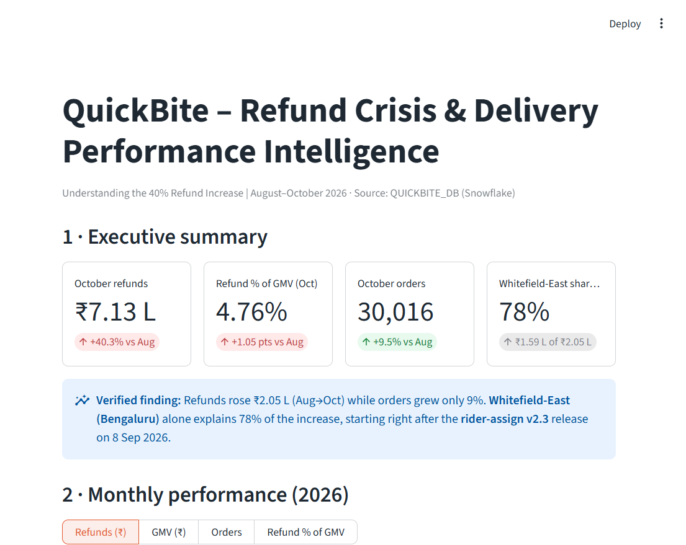
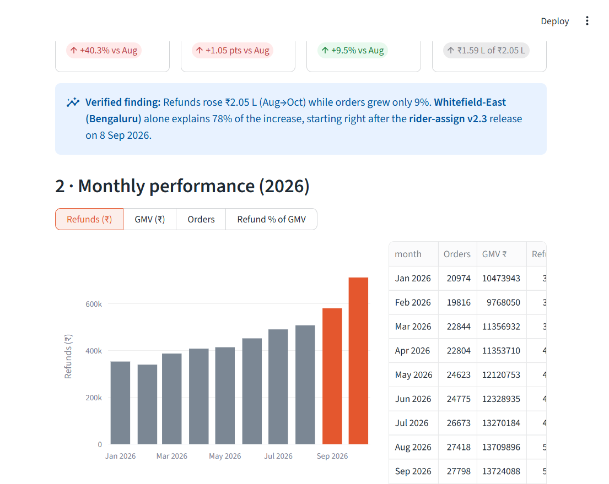
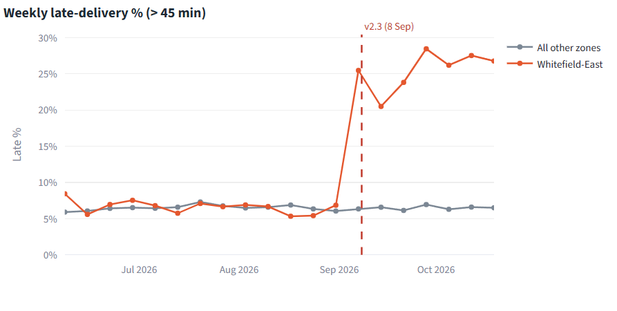
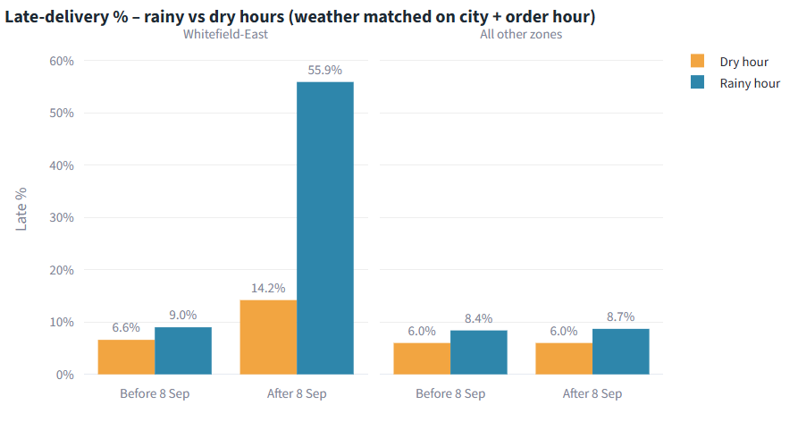
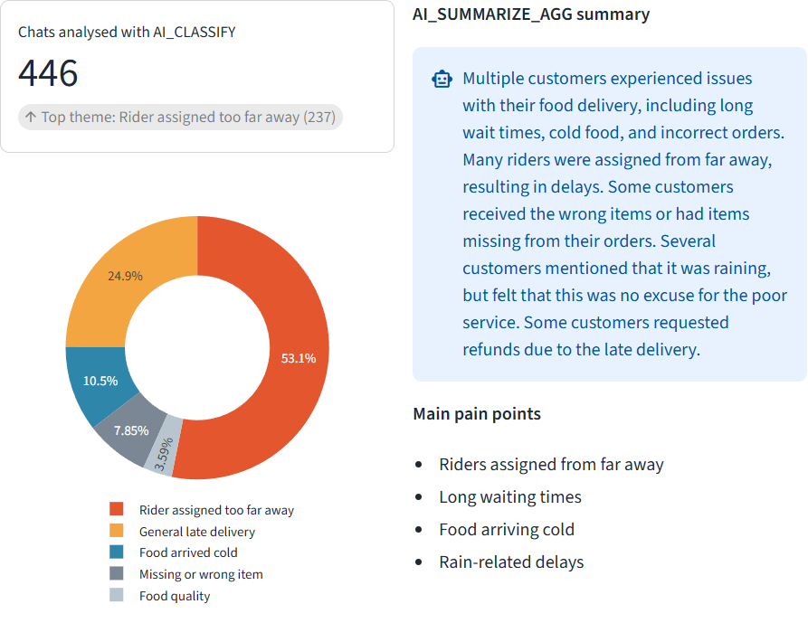
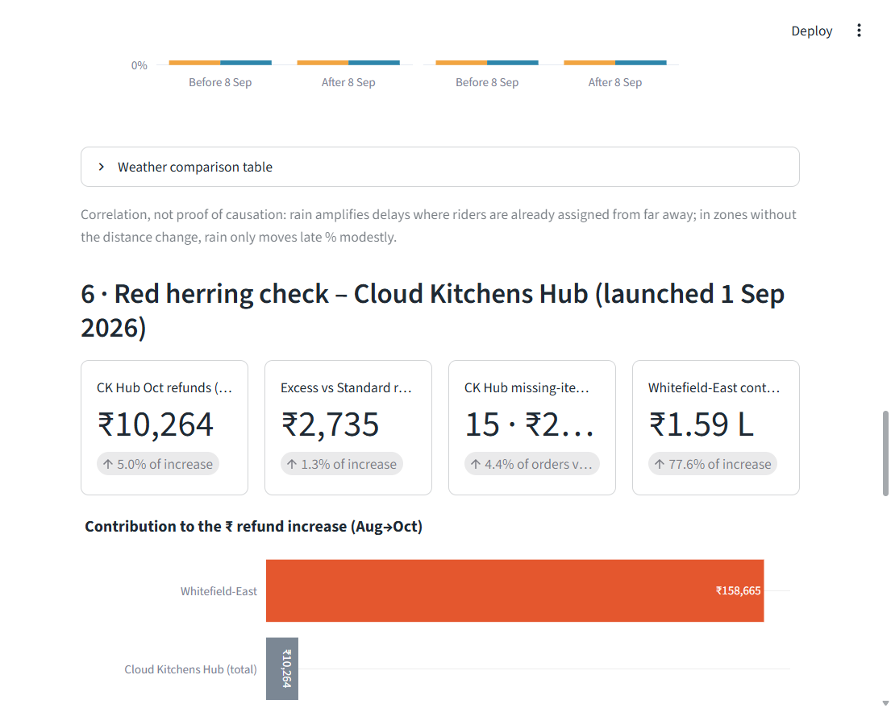

# ❄️ Snowflake Cortex Code – QuickBite Analytics Lab

### Why Is My Biryani Always Late?

An end-to-end hands-on project exploring Snowflake Cortex Code (CoCo), Cortex AI and Streamlit.

QuickBite is a fictional food-delivery company operating in six Indian cities. The COO reports:

> "Refunds are up 40% in two months and ratings are tanking. Board call at 5 PM. What's going on, and what do we fix?"

Using only natural-language prompts in Cortex Code, you load raw CSV data into Snowflake, investigate the refund spike, find the operational root cause, analyse customer complaints with Cortex AI, and ship a board-ready Streamlit dashboard.



## 🚀 Project highlights

- AI-assisted data exploration with Snowflake Cortex Code
- CSV ingestion into Snowflake (stage → `INFER_SCHEMA` → `COPY INTO`)
- SQL business analytics: monthly KPIs, zone attribution, before/after analysis
- Root cause analysis using app-release history and hourly weather data
- Complaint classification with `AI_CLASSIFY` and summarisation with `AI_SUMMARIZE_AGG`
- Interactive Streamlit + Plotly executive dashboard
- Recommendations clearly separated from verified findings

## 🛠️ Technology stack

Snowflake · Snowflake Cortex Code (CoCo) · Cortex AI · SQL · Python · Streamlit · Plotly

## 🔄 Workflow

```text
 Raw CSV data (10 files)
        │   PUT → stage → INFER_SCHEMA → COPY INTO
        ▼
 Snowflake Cortex Code (CoCo)  ── natural-language prompts drive every step
        │
        ▼
 Snowflake database  QUICKBITE_DB.RAW
        │
        ▼
 SQL analytics       monthly KPIs · zone attribution · release before/after · weather join
        │
        ▼
 Cortex AI           AI_CLASSIFY (5 complaint themes) · AI_SUMMARIZE_AGG
        │            → QUICKBITE_DB.ANALYTICS
        ▼
 Customer complaint intelligence
        │
        ▼
 Streamlit + Plotly dashboard
        │
        ▼
 Executive insights & recommendations
```

See [docs/architecture.md](docs/architecture.md) for the data model.

## 📸 Screenshots from my implementation

These are captured from the running dashboard, against real query results.

| Monthly refunds | Weekly late-delivery %: Whitefield-East vs others |
|---|---|
|  |  |
| **Rain amplifies the problem** | **Cortex AI complaint intelligence** |
|  |  |
| **Red herring: Cloud Kitchens Hub** | |
|  | |

## 📂 Repository structure

```text
├── prompts/            Step-by-step CoCo prompts (00–07) + master-prompt.md
├── dashboard/          Streamlit app (app.py), requirements, run instructions
├── docs/               Setup guide, architecture, expected results
├── screenshots/        Dashboard preview
├── CONTRIBUTING.md
└── LICENSE
```

## ⚡ Quick start

1. Set up a Snowflake trial account and Cortex Code Desktop. See [docs/setup-guide.md](docs/setup-guide.md).
2. Get the `quickbite_data` CSV files from the official lab materials and extract them locally. **The dataset is not included in this repository.**
3. Choose one of two paths:
   - **Guided:** run [prompts/00-setup-verification.md](prompts/00-setup-verification.md) → `07` in order.
   - **One shot:** paste [prompts/master-prompt.md](prompts/master-prompt.md) into CoCo.
4. Compare your numbers with [docs/expected-results.md](docs/expected-results.md).
5. Run the dashboard yourself. See [dashboard/README.md](dashboard/README.md).

## 🔎 Spoiler: what the data shows

<details>
<summary>Click to reveal</summary>

- Refunds rose **40.3%** from Aug to Oct 2026, while orders grew only 9.5%.
- **Whitefield-East (Bengaluru)** accounts for **77.6%** of the increase, almost entirely from late delivery and cold food.
- The **rider-assign v2.3** release (8 Sep 2026) expanded the assignment radius to 10 km. In Whitefield-East, rider distance went from 2.1 to 6.0 km and late deliveries rose from 6.8% to 26.4%. Other zones were unchanged.
- **Rain amplifies the problem:** Whitefield-East saw 56% late deliveries in rainy hours versus 14% in dry hours.
- **Cloud Kitchens Hub** is a red herring: its share of the increase is small.
- **Cortex AI:** 53% of Whitefield-East complaints say the rider was assigned too far away.

</details>

## 📚 Learning outcomes

1. Snowflake account configuration and connectivity
2. Database, schema and role management
3. CSV data ingestion
4. Data exploration and analytics
5. Root cause investigation
6. Cortex AI functions
7. Streamlit dashboard development
8. Turning analysis into business decisions

## 🧭 Workshop material vs this implementation

| From the workshop (31 Oct 2026, Bengaluru) | Built here |
|---|---|
| The business scenario ("Why is my biryani always late?") | The prompts, rewritten as eight step-by-step files plus a master prompt |
| The synthetic QuickBite dataset (**not redistributed**) | The Streamlit + Plotly dashboard (`dashboard/app.py`) |
| The expected checkpoints (e.g. +40% refunds, Whitefield-East, rider-assign v2.3) | Validation of every checkpoint against live query results ([docs/expected-results.md](docs/expected-results.md)), including where my numbers differ and why |
| | Documented pitfalls: late-% definition, AI_CLASSIFY label wording, weekly-bucket bias, chart axis bug |
| | Architecture, setup guide, screenshots |

The workshop handout itself is not republished here.

## ⚠️ Notes

- The dataset is synthetic and belongs to the original lab authors. Obtain it from the official lab rather than from this repository.
- Never commit Snowflake credentials. The dashboard reads them from your local `~/.snowflake/config.toml`.

## 🤝 Acknowledgement

Inspired by the Snowflake Cortex Code Hands-On Lab held in Bengaluru on 31 October 2026. This repository is an independent learning resource and is not an official Snowflake publication.

---

**Built with curiosity, AI and data.**
